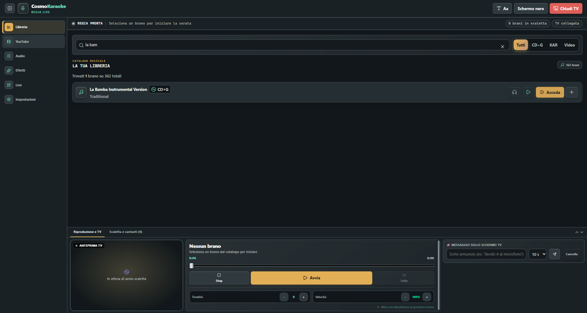

  
  <h1>CosmoKaraoke · Sito ufficiale</h1>
  
La regia delle tue serate karaoke.

  

    <a href="https://cosmonetinfo.github.io/CosmoKaraoke-Site/">Apri il sito</a> ·
    <a href="https://cosmonetinfo.github.io/CosmoKaraoke-Site/guida.html">Leggi la guida</a> ·
    <a href="https://cosmonetinfo.github.io/CosmoKaraoke-Site/feedback.html">Partecipa</a> ·
    <a href="https://cosmonetinfo.github.io/CosmoKaraoke-Site/download.html">Scarica l'app</a>
  

## Il progetto

Questo repository contiene il sito statico di presentazione di CosmoKaraoke, applicazione desktop per organizzare una serata karaoke. La pagina presenta le funzioni disponibili e usa schermate catturate dall'app reale; la guida online descrive installazione, libreria musicale, scaletta, audio, schermo TV e Live.

## Pagine del sito

- **Presentazione:** [index.html](index.html) — panoramica dell'app, funzioni e collegamenti alle release.
- **Download:** [download.html](download.html) — rileva l'ultima release e collega direttamente all'installer Windows `.exe` e al pacchetto macOS `.dmg`.
- **Guida utente:** [guida.html](guida.html) — istruzioni operative e risoluzione dei problemi.
- **Community:** [feedback.html](feedback.html) — moduli guidati per problemi, miglioramenti e funzioni nuove.
- **Stili e script:** `styles.css`, `download.css`, `download.js`, `community.css` — layout responsive e selezione dinamica dei pacchetti.
- **Immagini:** [assets/](assets/) — mascotte CosmoNet e schermate reali dell'app.

La guida è riferita a CosmoKaraoke **0.4.5**. I link del download vengono letti automaticamente dalla release GitHub più recente; dopo ogni nuova versione è comunque necessario rivedere le istruzioni e le schermate della guida.

## Aprire il sito in locale

È un sito statico: non servono dipendenze o compilazione. Apri `index.html` nel browser per la presentazione e `guida.html` per la guida.

## Pubblicazione con GitHub Pages

La repository è configurata per pubblicare la cartella principale di `main` con GitHub Pages. Se devi configurarla di nuovo:

1. Apri **Settings → Pages**.
2. In **Build and deployment**, scegli **Deploy from a branch**.
3. Seleziona `main` e `/(root)`, quindi salva.

Dopo il push, GitHub Pages aggiorna il sito su [cosmonetinfo.github.io/CosmoKaraoke-Site](https://cosmonetinfo.github.io/CosmoKaraoke-Site/).

## Aggiornare contenuti e immagini

1. Aggiorna `index.html` per la presentazione, `download.html`/`download.js` per il download o `guida.html` per le istruzioni.
2. Salva in `assets/` solo immagini autorizzate alla pubblicazione. Per schermate Live dimostrative, non includere QR o indirizzi attivi della rete locale.
3. Aggiorna questo README se cambiano le pagine o la versione descritta.
4. Invia le modifiche su `main`; GitHub Pages pubblica la nuova versione.

## Collegamenti

- [Repository dell'app](https://github.com/CosmoNetinfo/CosmoKaraoke)
- [Release e download](https://github.com/CosmoNetinfo/CosmoKaraoke/releases/latest)
- [Segnala un problema](https://github.com/CosmoNetinfo/CosmoKaraoke/issues)
